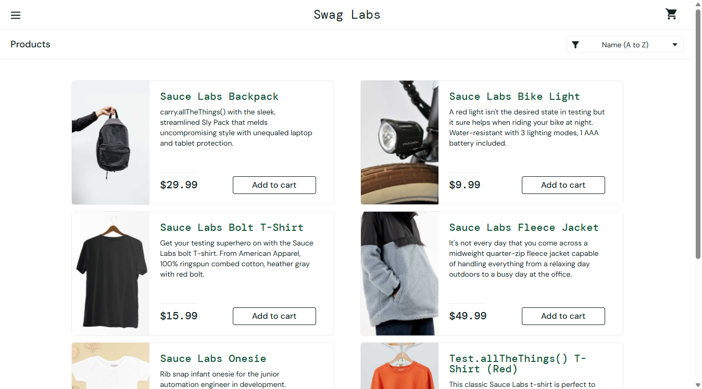
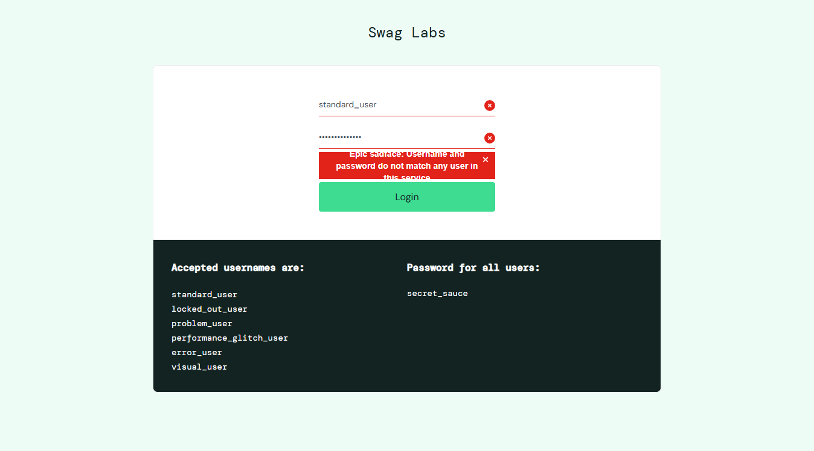
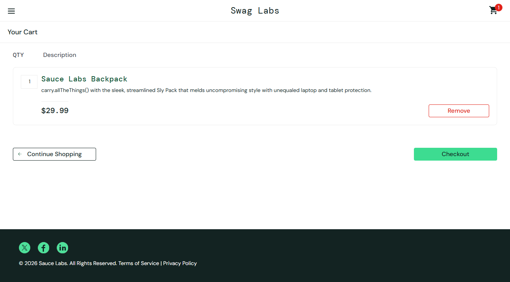
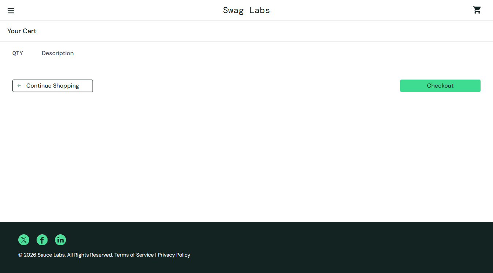
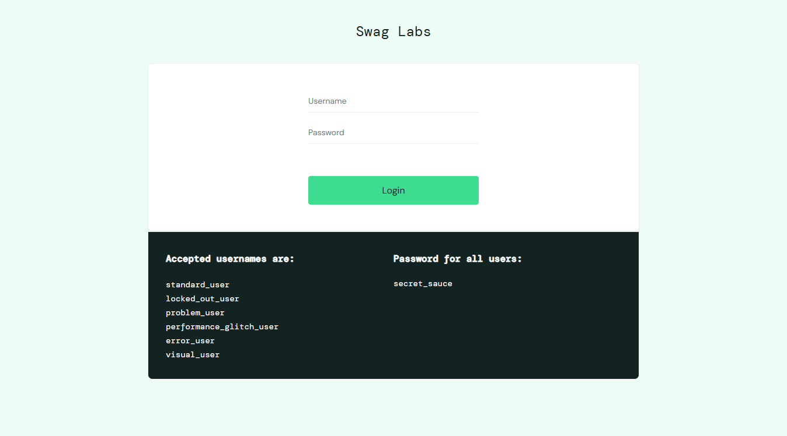

# Báo cáo thực hành kiểm thử tự động bằng Selenium

- **Họ tên:** Tống Sỹ Đại
- **MSSV:** 23010037
- **Website kiểm thử:** [SauceDemo](https://www.saucedemo.com/)
- **Công cụ:** Java + Selenium WebDriver + JUnit Jupiter + Maven.
- **Repository:** [tongDai-05/Selenium](https://github.com/tongDai-05/Selenium)

## 1. Yêu cầu bài thực hành

- Tìm hiểu Selenium qua video hướng dẫn hoặc tài liệu phù hợp.
- Xây dựng tối thiểu 05 test case kiểm thử tự động cho một website.
- Lưu mã nguồn và viết báo cáo trong README của repository GitHub.

Tài liệu đã tham khảo: [Selenium WebDriver](https://www.selenium.dev/documentation/webdriver/getting_started/) và [JUnit Jupiter](https://docs.junit.org/5.14.4/overview.html).

## 2. Các test case đã thực hiện

Mỗi test sử dụng một phiên Chrome riêng, tự chuẩn bị dữ liệu và dùng assertion của JUnit để kiểm tra kết quả. Tài khoản demo: `standard_user` / `secret_sauce`; sản phẩm: `Sauce Labs Backpack`.

| ID | Test case | Các bước chính | Kết quả mong đợi | Kết quả thực tế |
|---|---|---|---|---|
| TC01 | Đăng nhập hợp lệ | Nhập tài khoản demo → Login | Mở `/inventory.html`, hiển thị `Products` | PASS |
| TC02 | Đăng nhập sai mật khẩu | Nhập `standard_user` / `wrong_password` → Login | Hiện thông báo sai thông tin và vẫn ở trang đăng nhập | PASS |
| TC03 | Thêm sản phẩm vào giỏ | Đăng nhập → thêm Backpack → mở giỏ | Có đúng 1 sản phẩm Backpack, số lượng và huy hiệu giỏ là `1` | PASS |
| TC04 | Xóa sản phẩm khỏi giỏ | Đăng nhập → thêm Backpack → mở giỏ → Remove | Giỏ không còn sản phẩm, huy hiệu số lượng biến mất | PASS |
| TC05 | Đăng xuất | Đăng nhập → mở menu → Logout | Trở lại trang đăng nhập, hiển thị ô Username và nút Login | PASS |

## 3. Kết quả kiểm thử

Lần chạy thực tế ngày **21/10/2026**, kết thúc lúc **16:33:24 (UTC+7)**, trên Chrome headless:

```text
Tests run: 5, Failures: 0, Errors: 0, Skipped: 0
BUILD SUCCESS
```

Kết quả được đối chiếu từ Maven và báo cáo XML. Năm ảnh bên dưới được Selenium chụp trực tiếp sau khi các assertion của từng test thành công.

Mã kiểm thử nằm tại [`SauceDemoTest.java`](src/test/java/vn/edu/lab9/SauceDemoTest.java). Chạy tại thư mục chứa `pom.xml` bằng:

```powershell
mvn test
```

### TC01 — Đăng nhập thành công



### TC02 — Đăng nhập sai mật khẩu



### TC03 — Thêm sản phẩm vào giỏ



### TC04 — Xóa sản phẩm khỏi giỏ



### TC05 — Đăng xuất




